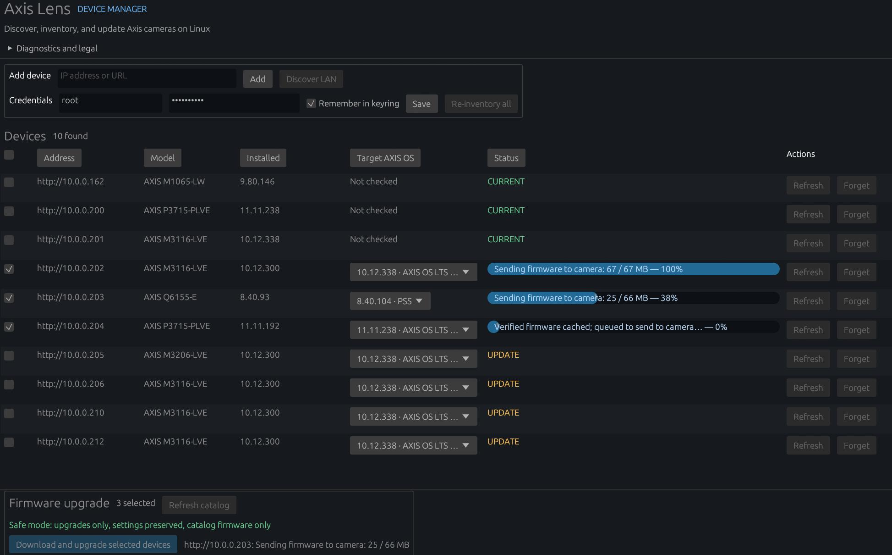
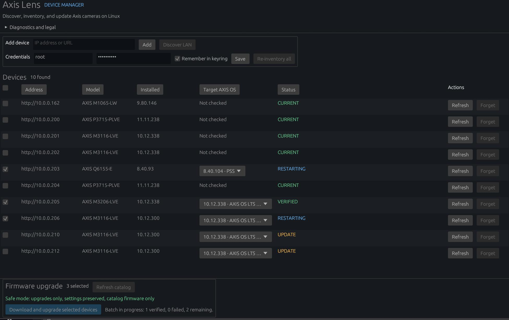

# Axis Device Manager for Linux

Do you own a bunch of axis cameras? Do you also use linux?

Well that sucks, right? Axis only makes management tools for windows! Boo!

I followed in the footsteps of the getartcraft project, and reversed and reimplemented the Axis Device Manager tool for linux! Now you dont have to run a vm to update your cams!






## Build from source

### 1. Install system dependencies

On Ubuntu or Debian:

```bash
sudo apt update
sudo apt install -y \
  build-essential \
  curl \
  git \
  pkg-config \
  libdbus-1-dev \
  libssl-dev \
  libx11-dev \
  libxi-dev \
  libxkbcommon-dev \
  libwayland-dev \
  libgl1-mesa-dev
```

On Fedora:

```bash
sudo dnf install -y \
  gcc \
  gcc-c++ \
  git \
  curl \
  pkgconf-pkg-config \
  dbus-devel \
  openssl-devel \
  libX11-devel \
  libXi-devel \
  libxkbcommon-devel \
  wayland-devel \
  mesa-libGL-devel
```

### 2. Install Rust

```bash
curl --proto '=https' --tlsv1.2 -sSf https://sh.rustup.rs | sh
source "$HOME/.cargo/env"
rustup update stable
```

Rust 1.88 or newer is recommended.

### 3. Clone the repository

Replace the URL below with this repository's GitHub URL:

```bash
git clone https://github.com/YOUR-USERNAME/axis-device-manager-for-linux.git
cd axis-device-manager-for-linux
```

### 4. Run the tests

```bash
cargo test --locked
```

Three tests that access the live Axis catalog are ignored by default. Run them separately with:

```bash
cargo test --locked -- --ignored
```

### 5. Compile and run locally

For a development build:

```bash
cargo run --locked
```

For an optimized build:

```bash
cargo build --release --locked
./target/release/axis-device-manager-for-linux
```

### 6. Build the AppImage

```bash
chmod +x scripts/build-appimage.sh
./scripts/build-appimage.sh
```

The build script downloads `appimagetool` when necessary. The finished files are written to the repository root:

```text
Axis_Device_Manager_for_Linux-<version>-x86_64.AppImage
SHA256SUMS
```

Verify the AppImage:

```bash
sha256sum -c SHA256SUMS
```

Run it:

```bash
chmod +x Axis_Device_Manager_for_Linux-*.AppImage
./Axis_Device_Manager_for_Linux-*.AppImage
```
